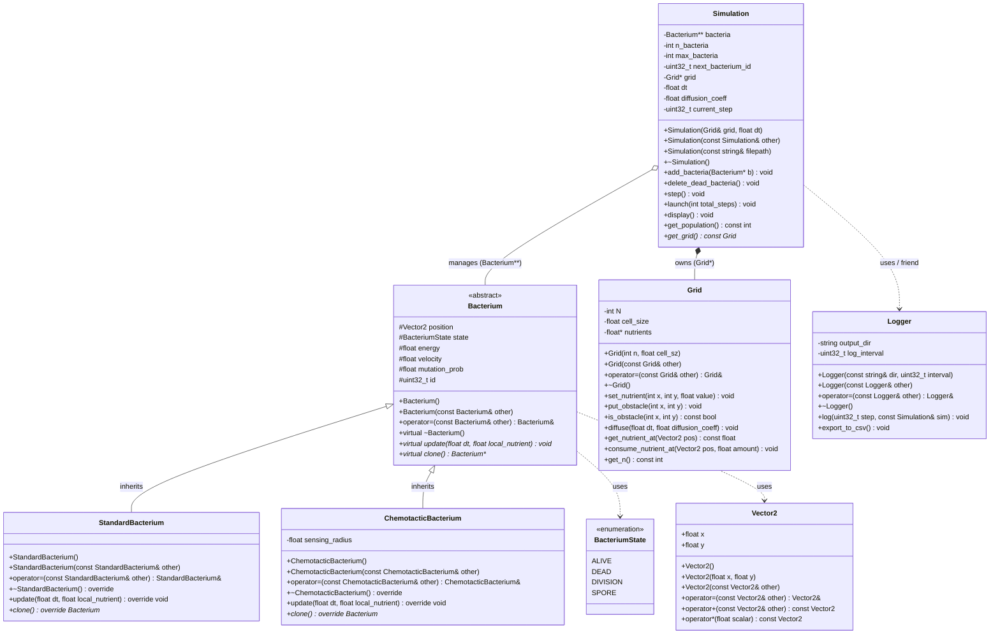
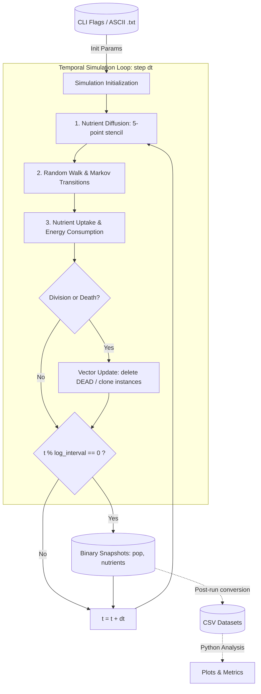

# BioChroma Pipeline and Architecture Description

> This document describes the system architecture, class relationships, and data pipeline of the project.

## Table of Contents
- [BioChroma Pipeline and Architecture Description](#biochroma-pipeline-and-architecture-description)
  - [Table of Contents](#table-of-contents)
  - [1. Project Overview](#1-project-overview)
  - [2. Architecture \& Class Diagrams](#2-architecture--class-diagrams)
    - [2.1 Data Structures](#21-data-structures)
    - [2.2 Class Diagram](#22-class-diagram)
  - [3. Data Pipeline](#3-data-pipeline)

---

## 1. Project Overview

This project is developed as an exploratory C++ portfolio project focused on scientific computing and software design. The primary goal is to implement complex Markov chain processes for multiple bacteria simulation in a virtual Petri dish.

Bacterial agents move, consume resources, undergo cell division, and interact locally. Their individual and collective evolution depends on:
- Nutrient availability across the continuous domain.
- Local population density (competition for resources and physical exclusion).
- Stochastic parameter mutations occurring during cell division.

Each bacterium is governed by an independent Markov process controlling state transitions (active, dividing, spore, or dead) and behavioral parameters (velocity, metabolic rate, chemotactic bias).

---

## 2. Architecture & Class Diagrams

Here are presented all the structures and classes used in the project.

### 2.1 Data Structures

**Cell States.** First, we need to define some basic structures. `BacteriumState` defines the current state of a `Bacterium` object: `DIVISION` means that the cell is dividing itself into two parts to produce two clones, and `SPORE` is an available state for `StandardBacterium` objects reached when nearby resources are too low.

**The Grid.** The Petri dish is modeled by an $N \times N$ discrete grid stored in a dynamically allocated `float` array (`nutrients`). This grid represents the local concentration of nutrients (normalized values between `0.0` and `9.0`), where `-1.0` encodes impenetrable obstacles (`#`). It is initialized directly by the `Simulation` parser from an ASCII configuration file.

> **NOTE**: Bacterial agents are not stored inside the grid cells. The `Simulation` orchestrator manages them on the heap through a dynamic pointer array (`Bacterium** bacteria`) using a Swap & Pop pattern for $\mathcal{O}(1)$ deletions. Continuous spatial coordinates ($\mathbb{R}^2$) are tracked via `Vector2`.

```cpp
// Internal states of a bacterium
enum class BacteriumState : uint8_t {
    ALIVE,      // Active agent: moves, feeds, metabolizes
    DEAD,       // Inactive agent scheduled for cleanup
    DIVISION,   // Undergoing binary fission
    SPORE       // Dormant state under severe nutrient scarcity
};
```

### 2.2 Class Diagram

**Simulation Objects.** Below are represented all the simulation classes and their inheritance and usage relationships. The main class is `Simulation`, which orchestrates the simulation steps, holding the environment `PetriDish` and managing all polymorphic `Bacterium` instances.

**Bacterium Types.** Two concrete `Bacterium` child classes are implemented:
- `StandardBacterium`: A basic bacterium walking randomly on the continuous domain, capable of entering a `SPORE` dormant state when local nutrient concentrations drop below a critical threshold.
- `ChemotacticBacterium`: Cannot enter spore state, but moves along the local nutrient gradient (chemotaxis) with higher motility.



---

## 3. Data Pipeline

The simulation runs through a discrete-time execution pipeline:
1. **Initialization**: The configuration file is parsed by `Simulation(filepath)`, allocating the internal `Grid*` buffer and initial `Bacterium*` heap pointers.
2. **Temporal Step** (`Simulation::step()`):
   - **2.1 Diffusion**: Nutrient diffusion runs across the grid via explicit finite differences (`grid->diffuse(dt, diffusion_coeff)`), preserving obstacle boundaries.
   - **2.2 Nutrient Intake & Metabolic Update**: Each active bacterium consumes available local nutrients (`grid->consume_nutrient_at`) and executes `b->update(dt, nut)`.
   - **2.3 Fission**: Cells flagged with `BacteriumState::DIVISION` spawn child instances via `b->clone()`, receiving a unique `next_bacterium_id`.
   - **2.4 Population Pruning**: Inactive agents flagged as `DEAD` are freed with `delete` and removed in $\mathcal{O}(1)$ using the Swap & Pop method.
3. **Visualization & Telemetry**: `Simulation::display()` prints ANSI-colored terminal views of the grid, nutrient densities, obstacles, and active agents.

